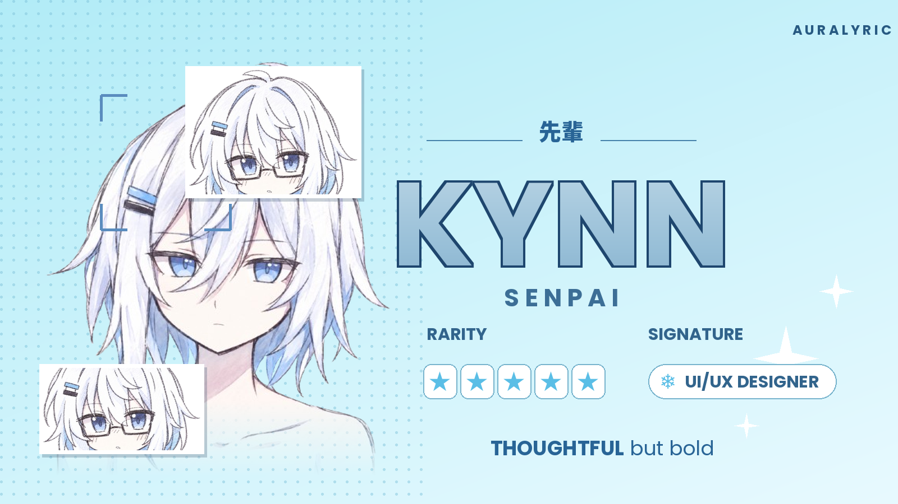

<h3>A music player that looks as good as it sounds.</h3>

 

---

## Download

1. Open the **[latest release](https://github.com/kenza11-star/Auralyric/releases/latest)**.
2. Download the file ending in **`-arm64-release.apk`**.
3. Open it on your phone. If Android asks, allow **Install unknown apps** for your browser or file manager.
4. Tap **Install**, then open **Auralyric**.

> **Requirements:** Android 7.0 (API 24) or newer, on a 64-bit ARM phone (almost every phone from the last several years).

Want a build from the latest development code instead? Open the **Actions** tab, pick the newest successful run, and download the `auralyric-arm64-release` artifact.

---

## What's inside

- **Synced lyrics** that follow along with the song.
- **Customisable home and icons**, including the anime launcher icons.
- **Developer playground** with live repo stats, issues and commits, right in the app.
- **Last.fm and Discord** integration, if you want it.

---

## Updating

Each release is signed separately, so Android may refuse to install a new APK over an old one. If that happens, uninstall Auralyric first, then install the new APK. Back up your library before uninstalling.

---

## Credits

Auralyric is built on open-source work from [ViviMusic](https://github.com/vivizzz007/ViMusic) and [Metrolist](https://github.com/MetrolistGroup/Metrolist). Thank you to everyone who contributed code, designs and feedback.

**Developers**
- **Kyn-X**: UI/UX & Product Design
- **Kenn**: Application Development

---

Licensed under the GPL-3.0. See <a href="https://github.com/kenza11-star/Auralyric/blob/main/LICENSE">LICENSE</a>.

